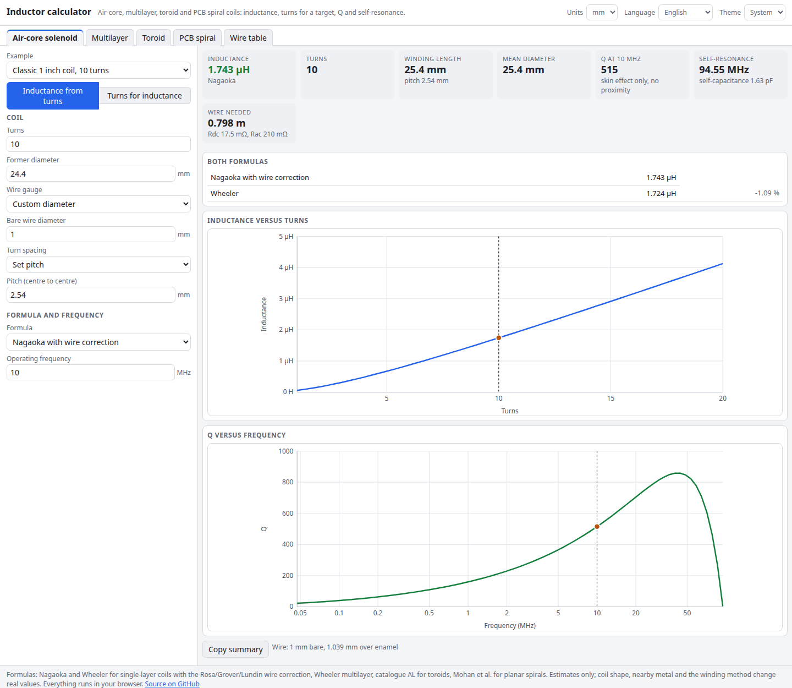

# Inductor Calculator

How many turns do you need for that inductance? This calculator handles single-layer air-core coils (Wheeler and Nagaoka with a round-wire correction), multilayer coils, Amidon and Micrometals style toroids (powdered iron T-series and ferrite FT-series), and PCB spiral inductors. It works both ways: give it the turns and get the inductance, or give it the inductance and get the turns. It also estimates Q and self-resonance, and includes a wire gauge table.

**Try it: [hermes98761234.github.io/inductor-calculator](https://hermes98761234.github.io/inductor-calculator/)**

[](https://github.com/hermes98761234/inductor-calculator/actions/workflows/deploy.yml)



## Features

- **Air-core solenoid.** Close-wound, set pitch or set length. Both Wheeler and Nagaoka are shown side by side; Nagaoka includes the Rosa/Grover/Lundin wire-spacing correction. Inverse design finds the turns for a target inductance.
- **Q and self-resonance.** Skin-effect resistance, Medhurst self-capacitance, SRF, and a Q-versus-frequency curve that collapses at resonance.
- **Multilayer coils.** Layer-wound geometry (turns per layer, layers, build) with Wheeler's multilayer formula.
- **Toroids.** 19 powdered-iron and 7 ferrite core sizes, 15 materials (mix -1 to -52, ferrite 31, 43, 52, 61, 73, 77). Catalogue AL for the common cores, AL computed from permeability and size for the rest. Turns for a target L, a table of every core size, flux density against saturation, winding fit and wire length.
- **PCB spirals.** Square, hexagonal, octagonal and circular layouts, with the modified Wheeler and current-sheet expressions of Mohan et al., trace resistance (with skin effect) and an upper bound for Q.
- **Wire table.** AWG 0000 to 40: diameter, enamelled diameter, area, ohms per km, turns per cm, and a current guideline.
- **Practical.** Examples to start from, millimetres, centimetres, inches or mils, English or Ukrainian, light or dark theme, and your inputs are remembered in the browser. Nothing leaves your machine.

## How it works

For a single-layer coil, the current-sheet inductance is `L = µ0·π·r²·N²·K / l`, where the Nagaoka coefficient `K` comes from complete elliptic integrals (computed with the arithmetic-geometric mean, so it is exact for any shape from a flat ring to a long solenoid). The wire correction subtracts `µ0·a·N·(A + B)`, with `A` for a round wire against a flat strip and `B` for the mutual inductance between separate turns, summed over the winding. Wheeler's `L = N²r² / (9r + 10l)` (inches, µH) is shown for comparison and agrees within about 1 % for ordinary coils.

Multilayer coils use `L = 0.8·a²N² / (6a + 9b + 10c)`. Toroids use `L = AL·N²`, with `AL = µ0·µi·Ae / le` from the core geometry when no catalogue value is bundled. PCB spirals use `L = K1·µ0·n²·davg / (1 + K2·ρ)`. The inverse mode solves for the turns by bisection (or by scanning whole turns for spirals).

The formulas are checked in the unit tests against Nagaoka's published coefficients, tabulated elliptic integrals, Wheeler's textbook example and hand-computed values.

Limits: Q and SRF are estimates (no proximity effect, no core loss, no substrate loss), toroid AL has a catalogue tolerance, and real coils depend on how they are wound and what is nearby.

## Quick start

You need [Node.js](https://nodejs.org/) 22.

```bash
git clone https://github.com/hermes98761234/inductor-calculator.git
cd inductor-calculator
npm install
npm run dev       # http://localhost:5173
npm test          # formula, model and i18n tests
npm run build     # static site in dist/
```

## License

MIT
